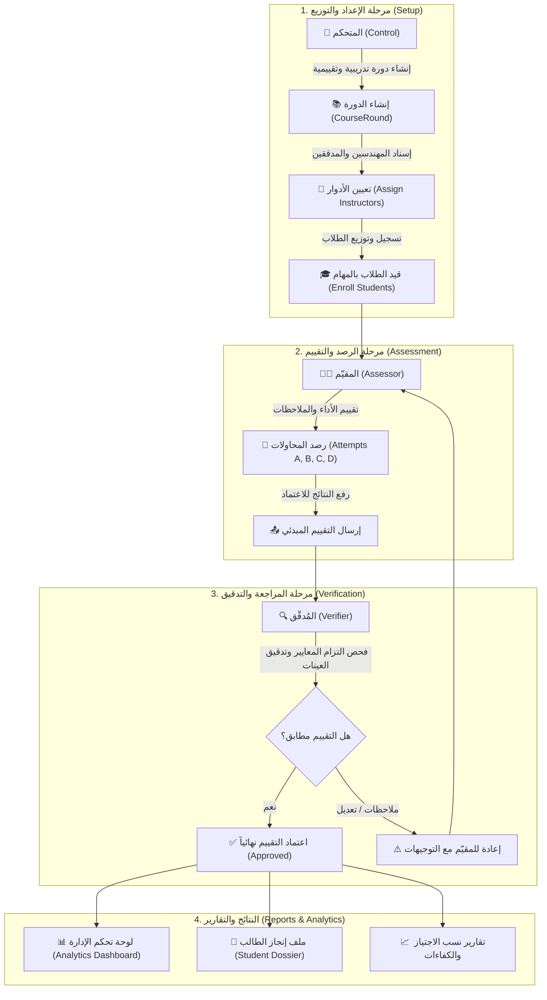

# 🎓 Elsewedy Assessment & Competency Management System

<div align="center">


**Enterprise Competency Assessment & Quality Verification Platform for Technical Academies**  
*مشروع تخرج وتقييم واعتماد الكفاءات الفنية - السويدي إلكتروميتر / أكاديمية السويدي الفنية (STA)*

[🚀 التشغيل السريع](#-التشغيل-السريع-getting-started) •
[👥 حسابات التجربة](#-حسابات-الدخول-المتاحة-للتجربة-pre-seeded-accounts) •
[🔄 مسار دورة التقييم](#-مسار-العمل-ودورة-التقييم-workflow) •
[🛠️ البنية التقنية](#-البنية-التقنية-tech-stack) •
[📂 هيكل المشروع](#-هيكل-المشروع-project-structure)

</div>

---

## 📌 نظرة عامة على المشروع (Project Overview)

منظومة **Elsewedy Assessment System** هي منصة رقمية متكاملة مصممة لإدارة واعتماد الكفاءات والمهارات الفنية لطلاب التعليم الفني والأكاديمي. تعتمد المنصة دورة عمل محكمة ثلاثية الأدوار (**Control**, **Assessor**, **Verifier**) تضمن نزاهة رصد الدرجات ودقة النتائج وفق معايير جودة صارمة، مع توفير لوحات تحليلات بيانية فورية للإدارة والمدربين.

### ✨ أبرز مميزات المنظومة:
- 🛡️ **دورة اعتماد ثلاثية الأدوار (3-Tier Quality Gate)**: فصل كامل للصلاحيات بين المتحكم (Control)، المقيّم الفني (Assessor)، والمدقق الداخلي للجودة (Verifier).
- 📝 **تقييم المهام التراكمي (Multi-Attempt Grading)**: دعم رصد محاولات التقييم المتتالية (A, B, C, D) لكل مهارة مع تسجيل التغذية الراجعة الفورية.
- 📊 **لوحات تحليلات وتقارير لحظية (Real-time Analytics)**: استعراض نسب النجاح، توزيع الدرجات، مؤشرات الأداء، وتحليل نقاط الضعف والقوة.
- 🤖 **التصحيح الآلي وفحص الانتحال (Automated Grading & Checks)**: واجهات مخصصة للتحقق من أمان ونزاهة الاختبارات.
- 🎨 **تصميم احترافي وفق هوية السويدي (Brand Identity)**: دعم كامل للوضعين الداكن والفاتح (Dark / Light Theme)، وتصميم متجاوب وسلس مبني بـ Tailwind CSS و Framer Motion.
- 🔌 **ربط سحابي مباشر (Cloud DB Integration)**: متصلة بقاعدة بيانات Microsoft SQL Server سحابية جاهزة ومجهزة بالبيانات الأولية.

---

## 🔄 مسار العمل ودورة التقييم (Workflow)



---

## 🛠️ البنية التقنية (Tech Stack)

### 🎨 الواجهة الأمامية (Frontend)
- **Framework**: [React 19](https://react.dev/) + [TypeScript](https://www.typescriptlang.org/)
- **Bundler & Dev Server**: [Vite 6](https://vitejs.dev/) مع ميزة الـ Reverse Proxy لمنع مشاكل CORS
- **Routing**: [React Router v7](https://reactrouter.com/) (SPA architecture)
- **Styling**: [Tailwind CSS v3](https://tailwindcss.com/) + Custom Elsewedy Electrometer Palette (`#c8102e`, `#07070a`)
- **UI Components**: [Radix UI Primitives](https://www.radix-ui.com/), [Lucide React Icons](https://lucide.dev/)
- **Animations**: [Framer Motion](https://www.framer.com/motion/) & CSS keyframes
- **State & Theme**: React Context API مع دعم `Dark / Light` Theme التلقائي

### ⚙️ الواجهة الخلفية (Backend)
- **Framework**: [ASP.NET Core Web API](https://learn.microsoft.com/aspnet/core) (.NET 10)
- **Architecture**: Clean Architecture / Repository Pattern / Scoped Dependency Injection
- **Data Access & ORM**: Entity Framework Core 10 (EF Core)
- **API Documentation**: Swagger / OpenAPI UI مدمج
- **Serializers**: System.Text.Json مع حماية `ReferenceHandler.IgnoreCycles`

### 🗄️ قاعدة البيانات (Database)
- **RDBMS**: Microsoft SQL Server (LocalDB / Express / Enterprise)
- **Database Name**: `ElsewedySchoolSys` (قاعدة البيانات الرسمية تضم **4,739 حساب** و **3,634 طالب** و **28 مادة تقييم فني**)
- **Backup & Restore**: يتوفر ملف النسخة الاحتياطية وسكربت استرجاع فوري بنقرة واحدة داخل المجلد `backend/Database/`

---

## 👥 حسابات الدخول المتاحة للتجربة (Live Database Accounts)

جميع الحسابات التالية حقيقية ومسجلة في قاعدة بيانات `ElsewedySchoolSys` وتعمل مباشرة:

| الدور (Role) | البريد الإلكتروني (Email) | كلمة المرور (Password) | الاسم والصلاحيات |
| :--- | :--- | :--- | :--- |
| **Control (مسؤول النظام)** | `admin@elsewedy.com` | `123` | **Lead User** - إدارة الدورات، تعيين المقيمين والمدققين، تسجيل الطلاب، والتقارير (`/controller/*`) |
| **Assessor (المُقيّم الفني)** | `teacher1@elsewedy.com` | `123` | **Eng. Zainab** - رصد درجات الطلاب، تقييم المحاولات A-D، والملاحظات (`/assessor/*`) |
| **Student (بوابة الطالب)** | `student1@elsewedy.com` | `123` | **Hussein Mohamed** - استعراض نتائج التقييمات، ملف الكفاءات، وسجل الأداء (`/dashboard`) |
| **Verifier (المُدقّق / QA)** | `student2@elsewedy.com` | `123` | **Hussein Mohamed (QA)** - مراجعة واعتماد التقييمات وتدقيق الجودة (`/verifier/*`) |

> 💡 **ميزة سريعة:** تحتوي صفحة تسجيل الدخول على أزرار **Quick Preset** تمكّنك من ملء بيانات أي دور بنقرة زر واحدة للتجربة الفورية!

---

## 🚀 التشغيل السريع (Getting Started)

### المتطلبات الأساسية (Prerequisites):
- تثبيت **[Node.js](https://nodejs.org/)** (الإصدار 20 أو أحدث)
- تثبيت **[.NET 10 SDK](https://dotnet.microsoft.com/download/dotnet/10.0)**
- تثبيت **SQL Server LocalDB** (مرفق مع Visual Studio) أو أي نسخة SQL Server

---

### 0️⃣ إعداد قاعدة البيانات (Database Setup - يُنفذ مرة واحدة)

لاسترجاع قاعدة البيانات الرسمية `ElsewedySchoolSys` ببياناتها الكاملة:

```powershell
powershell -ExecutionPolicy Bypass -File backend/Database/restore_database.ps1
```

---

### 1️⃣ تشغيل الـ Frontend (React + Vite)

افتح نافذة Terminal ونفّذ الأوامر التالية:

```bash
# الانتقال لمجلد الواجهة
cd frontend

# تثبيت الحزم (إذا لزم الأمر)
npm install --legacy-peer-deps

# تشغيل سيرفر التطوير
npm run dev
# (في بيئة Windows PowerShell يفضل استخدام: npm.cmd run dev)
```

- 🌐 رابط الواجهة: **`http://localhost:3000`**
- 🔑 صفحة تسجيل الدخول: **`http://localhost:3000/login`**

---

### 2️⃣ تشغيل الـ Backend (ASP.NET Core Web API)

في نافذة Terminal ثانية، شغّل الـ API:

```bash
# تشغيل الـ Backend من المسار الرئيسي:
dotnet run --project backend/AssessmentWebApi/AssessmentWebApi/AssessmentWebApi.csproj --launch-profile http
```

- 📡 عنوان الـ API المحلي: **`http://localhost:5247`**
- 📄 توثيق واختبار الـ API (Swagger UI): **`http://localhost:5247/swagger`**

---

## 📂 هيكل المشروع (Project Structure)

```text
sewedy-assessment-system/
├── frontend/                          # تطبيق العميل (React 19 + Vite SPA)
│   ├── public/                        # الملفات الثابتة، الشعارات، والأيقونات
│   ├── src/
│   │   ├── components/                # مكونات الواجهة المشتركة (UI, Layout, Modals)
│   │   ├── hooks/                     # Custom Hooks (useToast, useApi...)
│   │   ├── lib/                       # عملاء الـ API، إدارة الجلسات (Auth Context)، والأنواع
│   │   │   ├── api-client.ts          # دوال الاتصال بنقاط الـ API
│   │   │   ├── auth-context.tsx       # إدارة حالة تسجيل الدخول والأدوار
│   │   │   ├── theme-provider.tsx     # دعم الوضع الداكن والفاتح
│   │   │   └── types.ts               # تعريفات TypeScript
│   │   ├── pages/                     # شاشات النظام مقسمة حسب الأدوار
│   │   │   ├── login/                 # شاشة تسجيل الدخول التفاعلية
│   │   │   ├── controller/            # لوحة تحكم وإدارة المتحكم
│   │   │   ├── assessor/              # شاشات رصد درجات المقيّم
│   │   │   ├── verifier/              # شاشات مراجعة وتدقيق الدرجات
│   │   │   └── dashboard/             # لوحة تحكم الطالب وملف الإنجاز
│   │   ├── styles/                    # التنسيقات العامة والرسوم المتحركة
│   │   ├── App.tsx                    # شجرة التوجيه ومسارات التطبيق (React Router)
│   │   └── main.tsx                   # نقطة انطلاق وتركيب React
│   ├── index.html                     # الصفحة الرئيسية للـ SPA
│   ├── package.json                   # اعتماديات الواجهة الأمامية
│   └── vite.config.ts                 # إعدادات Vite والـ Proxy
│
├── backend/                           # الواجهة الخلفية (ASP.NET Core 10 Web API)
│   └── AssessmentWebApi/
│       ├── AssessmentWebApi/
│       │   ├── Controllers/           # وحدات التحكم (Auth, Students, Courses, Reports...)
│       │   ├── Data/                  # سياق قاعدة البيانات (AppDbContext)
│       │   ├── Dto's/                 # كائنات نقل البيانات (Request / Response DTOs)
│       │   ├── Models/                # نماذج الجداول والكيانات (Entities)
│       │   ├── Repository/            # طبقة المستودعات ونمط العمل (Repository Pattern)
│       │   ├── Program.cs             # إعدادات الخدمات، CORS، وخط المعالجة
│       │   └── appsettings.json       # إعدادات الاتصال بقاعدة البيانات السحابية
│       └── AssessmentWebApi.slnx      # ملف الحل (Solution)
│
├── docs/                              # مواصفات المشروع وخطط التنفيذ
├── package.json                       # السكربتات الموحدة على مستوى الـ Root
└── README.md                          # الدليل التوثيقي للمشروع
```

---

## 🔒 معايير الأمان وجودة البرمجيات (Security & Reliability)

- **حماية مسارات الواجهة (Role Guarding)**: توجيه تلقائي ومنع الوصول غير المصرح به للشاشات بناءً على صلاحيات الحساب.
- **تشفير كلمات المرور**: دعم تجزئة كلمات المرور وتأمين الاتصال بقاعدة البيانات.
- **CORS & Reverse Proxy**: تكوين دقيق لحماية الـ API والسماح فقط للأصول المصرح بها مع تسهيل التطوير المحلي عبر Proxy مدمج.
- **معالجة الأخطاء الشاملة**: تسجيل استثناءات الخادم وإرجاع رسائل خطأ دقيقة ومفهومة للمستخدم.

---

<div align="center">

**Developed with ❤️ for Elsewedy Technical Academy (STA) & Capstone Assessment Project**  
*All Rights Reserved © 2026*

</div>
