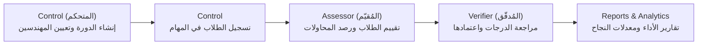

# 🎓 Elsewedy Assessment & Competency Management System
> **Enterprise Competency Assessment & Quality Verification Platform for Technical Academies**  
> Developed for **Elsewedy Electrometer / Elsewedy Technical Academy (STA)**

---

## 📌 نظرة عامة على المشروع (Project Overview)

منظومة تقييم واعتماد الكفاءات والمهارات الفنية لطلاب الأكاديمية، مبنية وفق أحدث معايير تجربة المستخدم وتعتمد دورة عمل ثلاثية الأدوار (**Control**, **Assessor**, **Verifier**) لضمان النزاهة ودقة النتائج وسرعة استخراج التقارير والتحليلات.

---

## 🛠️ البنية التقنية (Tech Stack)

### **Frontend (Node.js & React)**
- **Runtime & Tooling**: Node.js + Vite (Pure SPA without `.next`)
- **Framework**: React 19 & React Router DOM
- **Styling**: Tailwind CSS, Elsewedy Brand Identity (`#c8102e`)
- **Components**: Radix UI Primitives, Lucide Icons, Framer Motion
- **State & Theme**: React Context & Hooks, Theme Provider (Dark / Light)

### **Backend**
- **Framework**: ASP.NET Core Web API (.NET 10)
- **ORM**: Entity Framework Core 10
- **Architecture**: Repository Pattern, DTOs, Scoped Dependency Injection
- **Documentation**: Swagger / OpenAPI

### **Database**
- **Engine**: Microsoft SQL Server
- **Hosting**: Deployed Cloud Database (`db56344.public.databaseasp.net`)

---

## 👥 حسابات الدخول المتاحة للتجربة (Pre-seeded Accounts)

جميع الحسابات التالية نشطة ومسجلة مسبقاً في قاعدة البيانات السحابية:

| الدور (Role) | البريد الإلكتروني (Email) | كلمة المرور (Password) | الصلاحيات ومسار الواجهة |
| :--- | :--- | :--- | :--- |
| **Control (المتحكم)** | `controler@gmail.com` | `123456` | إدارة الدورات، تعيين المهندسين، تسجيل الطلاب، التقارير (`/controller/*`) |
| **Assessor (المُقيّم)** | `eng2@gmail.com` | `123456` | رصد درجات الطلاب، تقييم المهام والمحاولات A-D (`/assessor/*`) |
| **Verifier (المُدقّق)** | `eng@gmail.com` | `123456` | مراجعة واعتماد التقييمات وتدقيق النتائج المرفوعة (`/verifier/*`) |
| **Student (طالب)** | `ibrahim.adel1@school.com` | `123456` | حساب طالب مسجل بالدورة الحالية |
| **Student (طالب)** | `ahmed.sayed2@school.com` | `123456` | حساب طالب مسجل بالدورة الحالية |

---

## 🚀 التشغيل السريع (Getting Started)

### 1. تشغيل الـ Frontend (Node.js & React)
```bash
# تثبيت الاعتماديات
npm run build # أو npm install --prefix frontend --legacy-peer-deps

# تشغيل سيرفر التطوير
npm run dev
```
- التطبيق متاح على: **`http://localhost:3000`**
- صفحة تسجيل الدخول: **`http://localhost:3000/login`**

### 2. تشغيل الـ Backend (.NET Web API)
```bash
# تشغيل الـ Backend من المسار الرئيسي عبر Node.js:
npm run backend:dev

# أو عبر dotnet مباشرة:
dotnet run --project backend/AssessmentWebApi/AssessmentWebApi/AssessmentWebApi.csproj --launch-profile http
```
- يعمل السيرفر على: **`http://localhost:5247`**
- متصل مباشرة بقاعدة البيانات السحابية المرفوعة (`db56344`).

---

## 🔄 مسار العمل ودورة التقييم (Assessment Workflow)



1. **المتحكم (Control)**: يُنشئ الدورة التقييمية (`CourseRound`)، ويُسند المقيّمين والمدققين للمجموعات، ثم يُسجل الطلاب في المهام.
2. **المقيّم (Assessor)**: يستعرض قائمة الطلاب المسندين إليه، ويقوم برصد الدرجات والملاحظات وفق محاولات متتالية (A, B, C, D).
3. **المدقق (Verifier)**: يراجع سجل التقييمات والملاحظات للتأكد من التزام المعايير، مع إمكانية إضافة ملاحظات التدقيق.
4. **التقارير والإحصائيات**: لوحات تحكم تفاعلية توضح نسب الاجتياز، وتوزيع الدرجات ومؤشرات الأداء اللحظية.

---

## 📂 هيكل المشروع الجديد (Project Structure)

```text
sewedy-assessment-system/
├── frontend/                          # Client application (React 19 + Vite, Node.js runtime)
│   ├── public/                        # Static assets (logos, images)
│   ├── src/
│   │   ├── components/                # Reusable UI & layout components
│   │   ├── hooks/                     # Custom hooks (useApi, useToast)
│   │   ├── lib/                       # API clients, auth context, types
│   │   ├── pages/                     # Routed views (controller, assessor, verifier, student)
│   │   ├── styles/                    # Global CSS and animations
│   │   ├── App.tsx                    # React Router configuration
│   │   └── main.tsx                   # React root mount
│   ├── index.html                     # Entry HTML
│   ├── package.json                   # Frontend dependencies
│   └── vite.config.ts                 # Vite bundler & API proxy configuration
├── backend/                           # Isolated Backend (ASP.NET Core Web API)
│   └── AssessmentWebApi/
│       ├── AssessmentWebApi/
│       │   ├── Controllers/           # Controllers (Auth, Students, Courses...)
│       │   ├── Data/                  # AppDbContext
│       │   ├── Dto_s/                 # DTOs
│       │   └── Repository/            # Repository implementations
│       └── AssessmentWebApi.slnx      # Solution file
├── docs/                              # Superpowers specs & implementation plans
├── package.json                       # Root Node.js workspace orchestration
└── README.md                          # Documentation
```

---

## 🔒 الأمان وحماية البيانات (Security & Standards)
- تشفير كلمات المرور باستخدام **SHA-256** مع التحقق من الهوية وصلاحيات الدور.
- تصفية الصلاحيات على مستوى الـ Routing في الـ Frontend وحماية مسارات الـ API في الـ Backend.
- تسجيل العمليات في سجل التدقيق الموحد (`AuditLog`).
